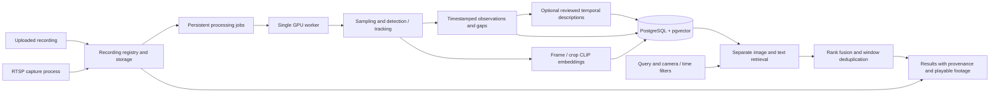

# Evolving the text-guided CCTV retrieval application

This is a proposal grounded in the 16 November 2026 audit, not a claim that these
services already exist. Start with Stage 9 and evolve the PostgreSQL prototype.

## Approach and tradeoffs

1. **Recommended: evolve FastAPI/PostgreSQL.** Extract reusable model/processing
   code, adapt the existing OpenCLIP encoder, and expose small verified vertical
   slices. One relational authority simplifies provenance, time filters and jobs.
   Cost: importing older SQLite/Chroma results needs an explicit mapping.
2. **Extend SQLite/Chroma as the product.** Reuses more CLI features immediately,
   but preserves dual authorities and the older scope. Keep it as an evaluation
   baseline rather than expanding it into the current application.
3. **Rewrite everything.** Offers a clean structure but discards useful experiments
   and delays demonstration. Not justified.

The user authorized a small Stage 9 implementation and sensible reversible
defaults. Stage 9 therefore uses a standalone reusable module and file reports;
the larger architecture remains a proposal, with no schema changes applied.

## Proposed organization

```text
scene-search-prototype/       # preserved Stage 1–8 experiments
src/                         # preserved legacy CLI; additive Stage 9 modules now
  object_state.py            # pure label import and spatial analysis
  stage9.py                  # local CLI and reproducible output artifacts
backend/                     # introduced incrementally, not scaffolded now
  api/                       # recordings, jobs, search, media, cameras
  recordings/                # metadata, allowed storage paths, clip service
  processing/                # sampling, detection/tracking, object state, captions
  retrieval/                 # image/text indexes and fusion
  cameras/                   # lifecycle, capture/reconnect and recording segments
  persistence/               # config, pool, repositories and job claims
  worker.py                  # one bounded GPU-processing worker
  migrations/                # inspected baseline plus additive Alembic revisions
frontend/                    # React + TypeScript when playback API is usable
tests/                       # unit and opt-in integration/evaluation tests
docs/                        # audit, architecture, experiments, runnable guides
```

Move proven functions only when their callers/tests can migrate together. Do not
import FastAPI configuration just to compute geometry or decode video. Avoid
renaming the prototype or replacing the legacy CLI in the first increment.

## Pipeline and services



Capture remains independent of AI work. Use inexpensive detection/tracking at an
evaluated rate, representative image embeddings and sparse temporal descriptions.
Begin with the existing YOLO11n/ByteTrack experiment, keep other configurations as
baselines, and benchmark before changing models. Run large VLMs sequentially with
other GPU jobs and release them between phases; retain a small CLIP encoder only
if measured memory headroom permits. CPU fallbacks should be explicit.

Object state reports image coordinates, detector scores, track gaps and possible
fragmentation. Camera motion, object pose, occlusion and noisy boxes make these
uncertain observations. Semantic surface labels and physical movement require
additional reviewed visual context. No automatic track merging or mandatory
cross-camera identity matching, and no separate Evidence-Verification Module.

## Additive database evolution (proposal only)

First capture the current schema as an Alembic baseline; compare against live
tables before stamping. Back up and test restoration. Do not run a blanket
`create_all`, replace tables, or apply constraints that reject preserved seeds.

- `cameras`: stable ID, name, authorized target reference, monitoring state;
  credentials supplied separately and excluded from responses/logs.
- Extend `video_recordings`: source kind, camera relationship, managed storage
  reference, full content hash, dimensions, optional recording start UTC and
  explicit timeline source; retain existing video IDs and paths during migration.
- `processing_runs` / `processing_jobs`: source hash, model/settings versions,
  job state, stage, checkpoint, processed timestamp watermark, lease/heartbeat,
  attempt count, progress and sanitized failure. Runs are immutable provenance.
- `object_observations`: run + recording + camera scope, frame/PTS, nullable local
  track ID, class, raw confidence, bbox and review status. Index recording/time
  and scoped track/time; preserve untracked and overlapping observations.
- `event_windows`: source range, selected observations/frames, generated text,
  model/prompt/settings, review status/actor/time and corrections. Add explicit
  provenance to `scenes` without overwriting existing captions.
- `visual_embeddings`: **vector(512)** for the existing ViT-B-32 encoder, with
  model/preprocess/version, variant, frame/crop reference and unique source/run
  key. Keep MiniLM **vector(384)** text embeddings separate. Model identity matters
  even when dimensions coincide; no cross-space vector comparison.
- `camera_segments`: capture session, camera, storage reference, start/end capture
  UTC, discontinuities and indexing watermark. Do not invent uninterrupted time
  across reconnects. Retention must account for clips and dependent index rows.

Initially use exact similarity scans. Add and benchmark cosine HNSW indexes only
as volume warrants. pgvector documents model/dimension separation and partial
expression indexes for mixed-dimension collections; separate typed tables are
simpler here ([pgvector documentation](https://github.com/pgvector/pgvector)).

## Retrieval and playback

Apply camera/recording/time predicates to both channels. Encode queries with the
matching CLIP text encoder for images and MiniLM for scene text. Search each
channel independently, then start with reciprocal rank fusion over timestamped
windows. Record channel ranks and contributions; evaluate weights/RRF settings
against held-out queries, not arbitrary similarity cutoffs. Merge overlapping
results carefully so repeated frames do not dominate the result list.

Return observed detections and generated interpretations with visibly different
provenance. Scores are relevance measures, not probabilities. Last-observed search
returns the latest matching indexed observation with ambiguity and an indexed-up-to
watermark; multiple same-class objects stay separate. Absolute date filters need
real recording start metadata, not the image's printed clock or file mtime.

Use generated recording/clip IDs and storage-root containment, authenticated
authorization, byte-range compatible source playback or H.264 clips. Invoke
FFmpeg with an argument list, bounded times, timeouts and controlled output paths.
Test seeks, partial clips and corrupt input before calling playback complete.

## Jobs and live cameras

For one Windows laptop, use a dedicated worker process and PostgreSQL jobs with
transactional claim/lease semantics (e.g. `FOR UPDATE SKIP LOCKED`). One GPU job
at a time initially; no Redis, Celery or Kubernetes required. Commit useful chunks
and progress atomically, support retries/idempotency by source/run/window keys,
and recover expired leases after interruption. Cap queue depth and disk usage.

RTSP capture runs in separate supervised processes, recording short segments with
FFmpeg and reconnecting with bounded backoff. Index closed segments independently
and preserve session discontinuities. Start with local MediaMTX, then authorized
physical cameras. Use permitted networks/hosts and validate resolved addresses;
keep RTSP credentials out of process diagnostics/API payloads. Browser viewing
needs HLS/WebRTC or another compatible bridge rather than a raw RTSP video URL.
ONVIF is optional. Measure capture-to-index latency, backlog and reconnect losses.

## Frontend strategy

Build React/TypeScript after upload/job/search/playback contracts work. Begin with
one usable recording upload → progress → search → seek/play flow, then add camera
management and indexed history. Use one coherent navigation shell; show failure
and partial-index states, provenance, filters and processing watermarks. Stakeholders
should operate through the UI. Avoid placeholder controls for unfinished features.

## Demonstrable sequence and verification

| Increment | Runnable outcome | Verification |
| --- | --- | --- |
| 9a — this change | Import saved tracks; coordinates, gaps, spatial candidates, final observed boxes, review CSV | Hand-calculated fixtures + real backpack export, no DB/GPU |
| 9b | Reviewed frame/box identity annotations; assess fragments, detector jitter and camera motion | Human-reviewed trajectories; false movement/missed movement rates |
| 10 | Adapt existing CLIP encoder to representative frames/crops and pgvector | Same-model 512-d vectors, idempotent imports, positive/negative queries |
| 11 | Filtered hybrid window ranking | Text-only vs CLIP vs fusion on multiple recordings/objects, Precision@K, Recall@K, MRR/nDCG |
| 12 | Search result plays/seek correctly in browser | Range requests, clip bounds, traversal rejection and source authorization |
| 13 | Persistent upload/index jobs and migrated schema | Restart/retry tests, status updates, failed/corrupt files, no data loss |
| 14 | Complete recorded-footage UI | User workflow checks with a stakeholder and measured time-to-find |
| 15 | Long recordings with incremental indexing | Throughput, RAM/VRAM, disk, search latency and backlog under load |
| 16 | Local RTSP preview + recorded searchable history | MediaMTX interruption/reconnect, latency/watermark, then physical camera |
| 17–18 | Defensible evaluation and reproducible demonstration | Frozen held-out dataset, versions/settings, ground truth, setup/restore guide |

Across evaluation, separate manual annotations, model predictions and corrections.
Measure object detection precision/recall and tracking continuity/ID switches only
against reviewed box/identity annotations. Evaluate temporal description errors and
hallucinations by human review. Report hardware, data splits, sampling rates and
uncertainty; the single ten-second clip cannot support general accuracy claims.
